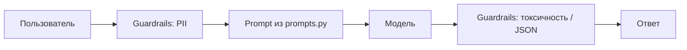

# Prompt-Engineering-Lab
Experiments with prompt engineering, RICCE, few-shot prompting and LLM evaluation.

## Оценка

- Тест-кейсов: 3
- Пройдено: 2 из 3
- Что проверяли: корректность формата ответа, отсутствие галлюцинаций, безопасность (фильтр PII).

## Ограничения

- Проект работает в демо-режиме без API-ключей, поэтому качество ответов ограничено.
- Модель не гарантирует согласованность фактов — для production нужен конвейер оценки (RAGAS, AI-судья).
- Для production нужно: подключить реальную модель, добавить мониторинг, настроить guardrails на входе и выходе.

## Архитектура

